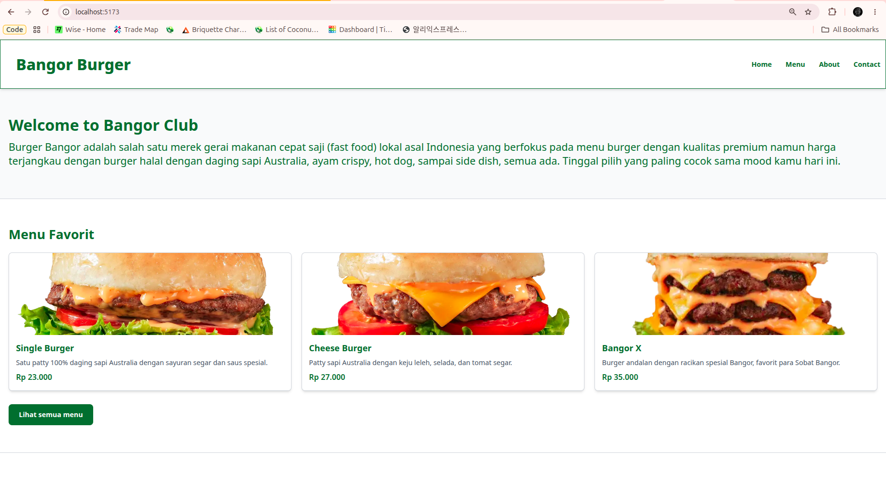
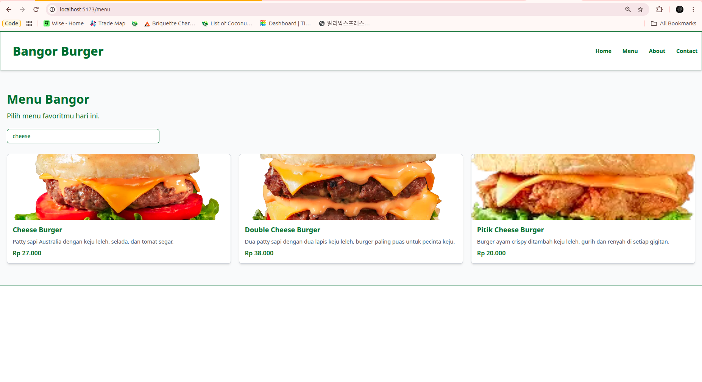
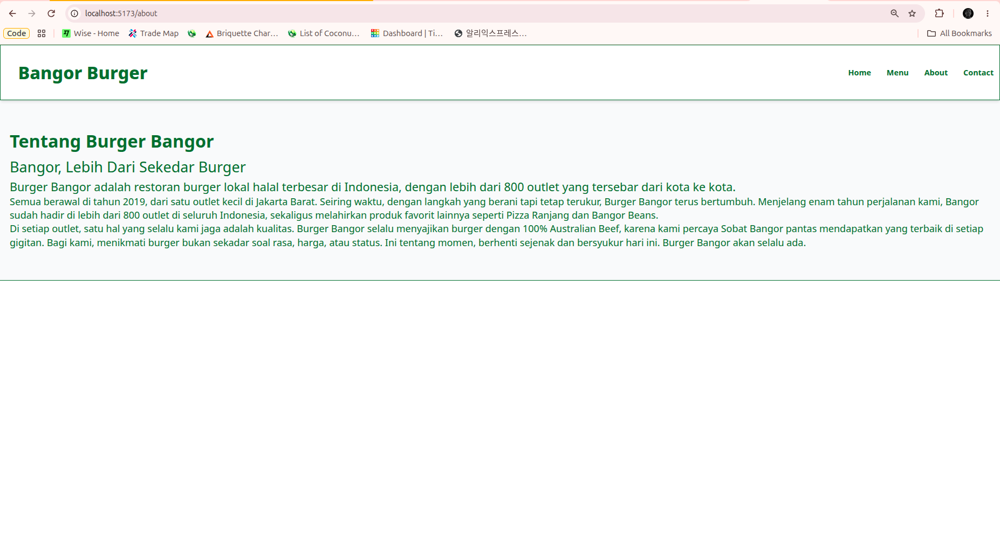
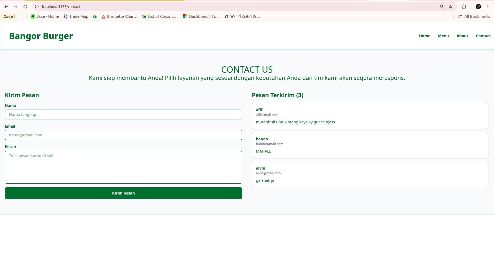

# Bangor Burger – Homework 2 (React & Tailwind)

## Deskripsi Singkat
Website restoran **Bangor Burger** yang dibuat dengan React JS, React Router, dan Tailwind CSS. Website memiliki halaman Home (info usaha + menu favorit), Menu (daftar produk + pencarian), About, dan Contact (form pesan yang disimpan di localStorage). Tampilan responsif untuk mobile, tablet, dan desktop.

## Fitur
- Navigasi antarhalaman dengan React Router (navbar responsif dengan tombol hamburger di layar kecil)
- Menampilkan 7 produk (gambar, nama, harga, deskripsi) lewat reusable component `ProductCard`
- Pencarian menu berdasarkan nama (`SearchBar` + state)
- Form Contact (nama, email, pesan) dengan validasi
- Pesan tersimpan di `localStorage` dan seluruh pesan ditampilkan di bawah/di samping form

## Screenshot
| Halaman | Screenshot |
|---|---|
| Home |  |
| Menu |  |
| Menu |  |
| About |  |
| Contact |  |

## Alur Penggunaan
**Navigasi**
1. Buka website, halaman awal adalah **Home**.
2. Klik link **Home / Menu / About / Contact** di navbar untuk berpindah halaman. Di layar kecil, klik tombol **Menu** di pojok kanan atas untuk membuka navbar.

**Pencarian Menu**
1. Buka halaman **Menu**.
2. Ketik nama produk di kolom pencarian.
3. Daftar produk otomatis tersaring. Jika tidak ada yang cocok, muncul pesan "Menu tidak ditemukan".

**Pengiriman Pesan**
1. Buka halaman **Contact**.
2. Isi **Nama**, **Email**, dan **Pesan** (semua wajib diisi).
3. Klik **Kirim pesan**.
4. Pesan langsung muncul di daftar **Pesan Terkirim** dan tetap tersimpan walau halaman di-refresh (disimpan di localStorage dengan key `contactMessages`).

## Cara Menjalankan Project
```bash
# 1. Clone repository
git clone https://github.com/rifrifai/koda-b1-homework2_reactTailwindcss.git

# 2. Change directory
cd koda-b1-homework2_reactTailwindcss

# 3. Install dependency
npm install

# 4. Jalankan development server
npm run dev

# 5. Buka alamat http://localhost:5173
```
Dependency utama: `react`, `react-dom`, `react-router`, `tailwindcss`.

## Struktur Folder
```
src/
├── App.jsx
├── main.jsx
├── data/
│   └── products.js
└── Components/
    ├── Navbar.jsx
    ├── Home.jsx
    ├── Menu.jsx
    ├── About.jsx
    ├── Contact.jsx
    ├── UserSubmit.jsx
    ├── ProductCard.jsx
    ├── SearchBar.jsx
    └── MessageItem.jsx
public/
├── screenshots/
│   └── (gambar screenshots)
└── images/
    └── (gambar produk)

```